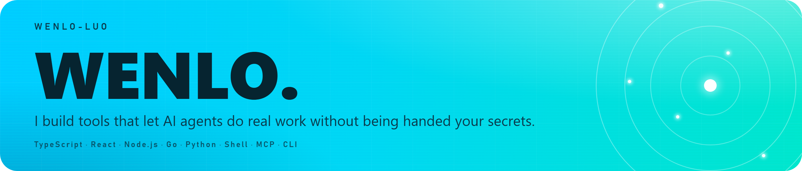

<table width="100%">
  <tr>
    <td align="center" width="25%" valign="top">
      
       
      <a href="https://github.com/wenlo-luo/agent-skill-forge">curated-agent-skills</a>
      
主推·找包工头点这里 两枚 skill，审阅脱敏后公开。 ✅ 包工头派活并验收 ⚠️ 2 个 skill，先装 Herdr 适合 跨 CLI 派活、长任务 不适合 单文件小改 → <a href="https://github.com/wenlo-luo/agent-skill-forge">包工头·全部</a>

    </td>
    <td align="center" width="25%" valign="top">
      
       
      <a href="https://github.com/wenlo-luo/keyseal">keyseal</a>
      
主力·手机批密钥 指纹在手机上批准，密钥直达进程。 ✅ 明文不进对话和磁盘 ⚠️ 桌面仅 Win 实测 适合 无屏服务器、CI 里取密钥 不适合 当日常密码管理器 → <a href="https://github.com/wenlo-luo/keyseal">下载·站点</a>

    </td>
    <td align="center" width="25%" valign="top">
      
       
      <a href="https://github.com/wenlo-luo/wenlo-bot">wenlo-bot</a>
      
主力·数字员工团队 说一句需求，负责人拆解派工。 ✅ 员工各有模型和记忆 ⚠️ 绑 DSH 0.2.1-rc.2 适合 多步骤调研、整理加出稿 不适合 偶尔问一两句 → <a href="https://github.com/wenlo-luo/wenlo-bot">下载·快速开始</a>

    </td>
    <td align="center" width="25%" valign="top">
      
       
      <a href="https://github.com/wenlo-luo/Hy2-veil">Hy2-veil</a>
      
工具·一键装节点 可交给 agent 执行的 Hysteria 2 SOP。 ✅ 一键装完，带防泄露 ⚠️ 需自备 VPS，纯脚本 适合 自建节点、要防泄露分流 不适合 没有自己的服务器 → <a href="https://github.com/wenlo-luo/Hy2-veil">部署指南</a>

    </td>
  </tr>
</table>

怎么选 — 派活 → 包工头；给密钥 → keyseal；要团队 → wenlo-bot；缺节点 → Hy2-veil。

自用：<a href="https://github.com/wenlo-luo/kindle-gadget">kindle-gadget（越狱 Kindle 看板）</a> · <a href="https://github.com/wenlo-luo/keyseal">keyseal</a> · <a href="https://github.com/wenlo-luo/dycop-public">dycop-public</a>

